# GBVR-IOT

基于 [php-exosip](https://github.com/wzj177/php-exosip) / Swoole 协程 + [Webman](https://www.workerman.net/doc/webman) 实现的国标
GB28181 协议视频管理平台（含 ONVIF 网关）

> 前端管理界面：[PHP-GB28181-UI](https://github.com/wzj177/PHP-GB28181-UI)
>
> PHP SIP 扩展：[php-exosip](https://github.com/wzj177/php-exosip)
>
> 信令网关双引擎：`gb28181:server`（exosip C 扩展，稳定版）/ `gb28181:swoole`（Swoole 协程版，beta/2.0.0 起，业务流程与扩展版完全一致）

## 目录

- [效果预览](#效果预览)
- [演示站点](#演示站点)
- [核心功能](#核心功能)
- [快速开始](#快速开始)
- [信令网关启动](#信令网关启动)
- [文档导航](#文档导航)
- [相关仓库](#相关仓库)

## 效果预览

<details>
<summary><b>点击展开截图（12 张）</b></summary>

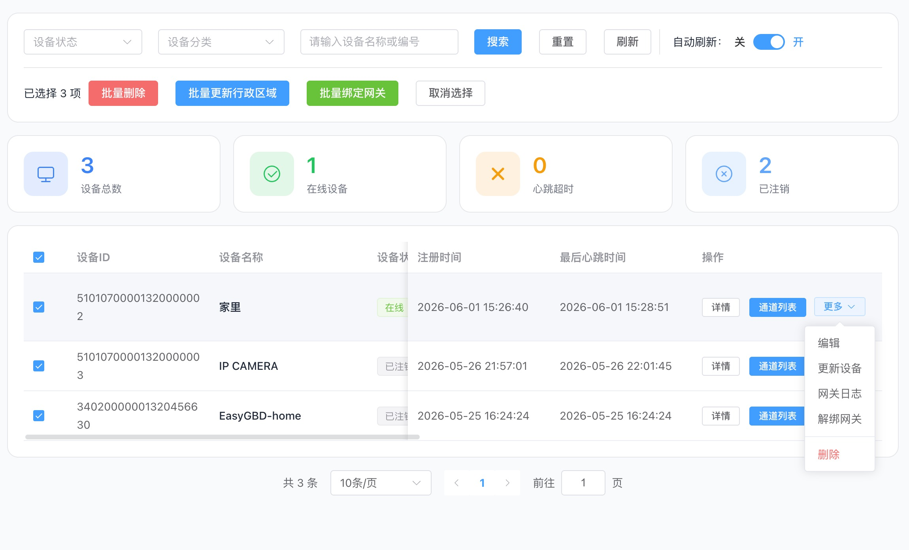
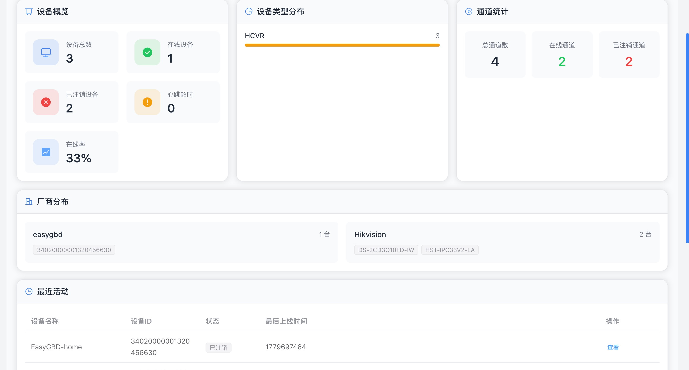

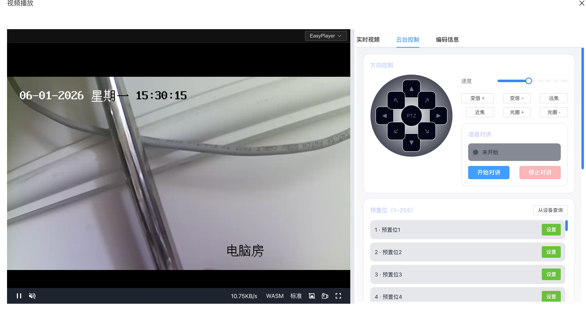
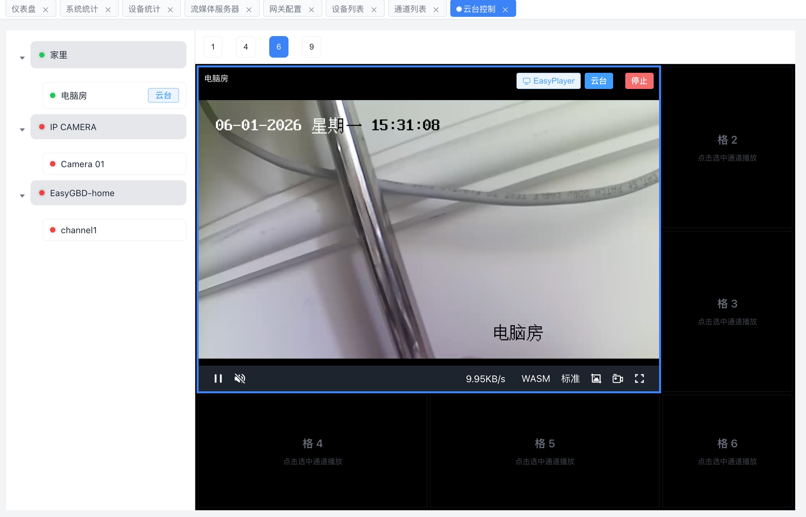
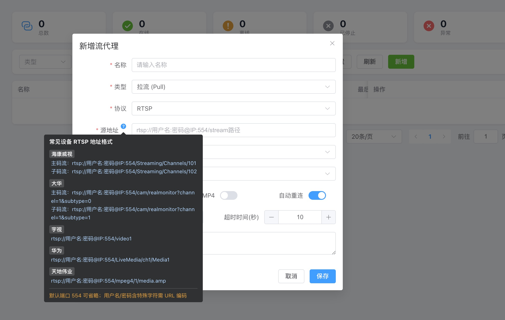
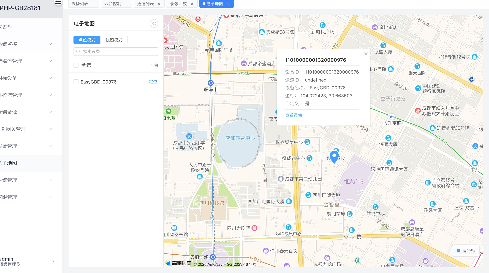
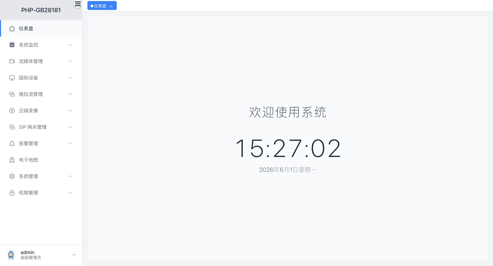
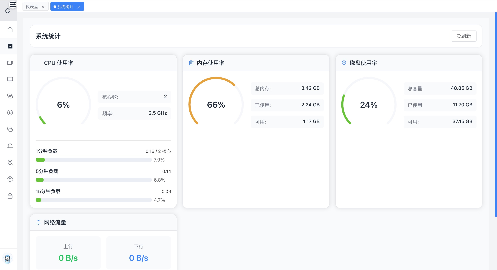
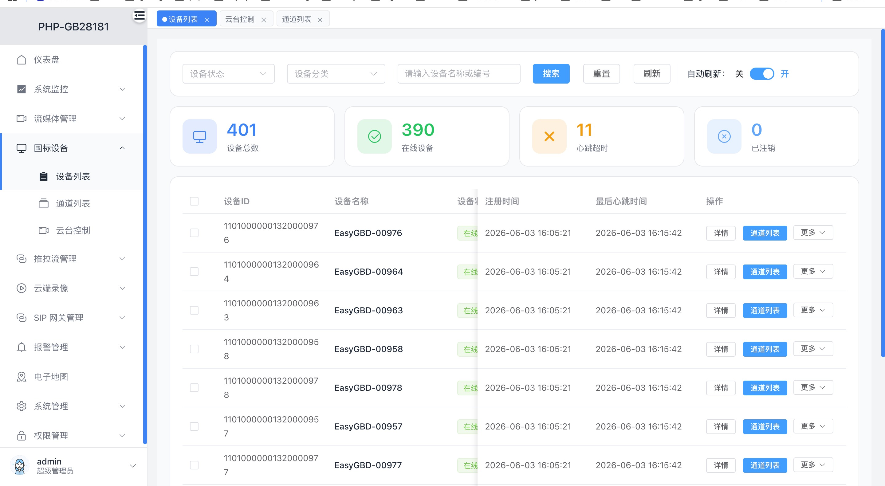
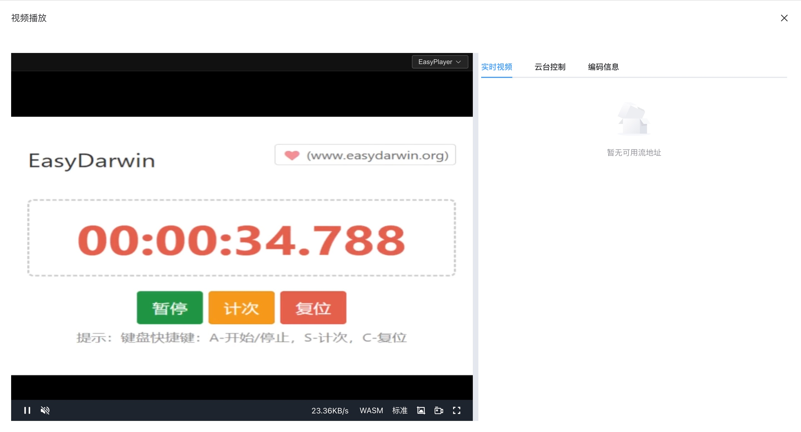
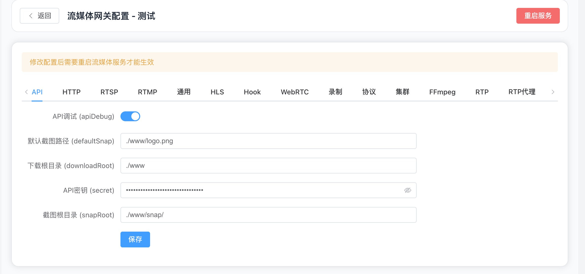

更多[>>>](./screenshots)

</details>

## 演示站点

- 演示地址：https://gbs.wanzij.cn
- 账号：admin / 密码：qwe123456@vr

<details>
<summary><b>交流群</b></summary>

</details>

## 核心功能

### 已完成的功能

- 完整的国标信令服务：设备直播、本地录像回放、本地录像回放下载、设备云台控制、设备位置上报等、报警事件
- 云端录像：录像查询、录像下载、录像回放器、录像合并
- 信令网关支持：TCP/UDP两种传输协议；集群部署；支持GB2011、GB2016、GB2022版本协议
- 流媒体服务：对接zlm/srs，支持国标摄像头rtp推流，集成非GB28181设备的拉流功能，实现除GB28181 Rtp流以外的其他流类型的拉取与转换
- 一张图：以高德/lefleat等地图sdk，实现设备一张图（设备点位、区域、预警）
- AI：视频文搜（近期整理好开源）
- openapi：完成了部分api，基本40%（开发者可以自行扩展，也可以联系我处理）

### 进行中功能

- 国标级联：扩展层已经实现完整的sipClient，php层面有完整的胶水类，待完善一个完整客户端长链接
- Swoole 协程版网关：beta/2.0.0 已发布（`gb28181:swoole` / `onvif:server`），线上真机联调中
- docker：网关镜像已支持（swoole-gbs/，linux/mac 双平台），api 整体镜像待完善

## 快速开始

### 环境要求

- PHP >= 8.2（扩展版网关需 [php-exosip](https://github.com/wzj177/php-exosip)；Swoole 版网关需 ext-swoole >= 4.5）
- Composer >= 2.0
- 内存至少 4GB（系统会使用ImageMagick处理全景图片，生成对应全景图片的低分辨率图：如果全景图片在20mb以上就会有很大的内存开销，如果内存不足会导致生成低分辨率图失败的可能）

### 安装

```shell script
composer install -vvv
cp .env.example .env   # 修改环境配置（一定阅读 .env.example 的注释）
bin/phpmig migrate     # 数据迁移
php webman system:init # 系统初始化
```

### 运行系统

```shell script
php start.php start       # 前台启动
php start.php restart -d  # 守护进程启动
php start.php reload      # 代码更新重载
# 其他：stop / status
```

## 信令网关启动

两个引擎版本**共用同一套业务层**，hook 协议、Redis 命令队列格式完全一致，
webman/API 侧无需任何改动即可切换；两个版本不可同时监听同一端口。

### Swoole 协程版（beta/2.0.0 起，推荐新部署）

```bash
php webman gb28181:swoole start            # UDP（--tcp 切 TCP；--gateway-id= 集群模式）
php webman gb28181:swoole status|stop|restart
php webman onvif:server start              # ONVIF 网关（发现 + 命令队列）
```

- 无需 exosip C 扩展，只需 ext-swoole；SIP 栈为纯 PHP 自解析实现
- Docker 部署（Linux/Mac 双平台）见 [swoole-gbs/README.md](./swoole-gbs/README.md)

### exosip 扩展版（稳定版）

```bash
cp config/gb28181.php.example config/gb28181.php       # UDP
cp config/gb28181_tcp.php.example config/gb28181_tcp.php  # TCP
php webman gb28181:server start          # UDP 启动
php webman gb28181:server start --tcp    # TCP 启动
```

网关与 API 分机部署、`gbs.php` 独立入口等进阶用法见 [部署指南](docs/%E9%83%A8%E7%BD%B2%E6%8C%87%E5%8D%97.md)。

## 文档导航

| 文档 | 内容 |
|---|---|
| [GB28181 信令网关指南](docs/GB28181%20%E4%BF%A1%E4%BB%A4%E7%BD%91%E5%85%B3%E6%8C%87%E5%8D%97.md) | 架构总览、RTP 传输模式选型、核心流程、API 集成 |
| [部署指南](docs/%E9%83%A8%E7%BD%B2%E6%8C%87%E5%8D%97.md) | 线上部署实操：api / 网关 / ZLM / nginx / supervisor / 端口 |
| [项目介绍](docs/%E9%A1%B9%E7%9B%AE%E4%BB%8B%E7%BB%8D.md) | 项目初衷、适用场景、常见问题、未测试功能清单 |
| [Swoole 版网关](swoole-gbs/README.md) | Swoole/ONVIF 网关架构、验证点清单、Docker 部署 |
| [php-exosip 扩展](docs/php-exosip-extension.md) | C 扩展 API 参考（扩展版引擎） |

## 相关仓库

| 仓库                                                         | 说明                                   |
|------------------------------------------------------------|--------------------------------------|
| [php-exosip](https://github.com/wzj177/php-exosip)         | PHP C 扩展，封装 eXosip2 提供 SIP 服务端/客户端能力 |
| [PHP-GB28181-UI](https://github.com/wzj177/PHP-GB28181-UI) | 管理后台前端（Vue.js），设备管理、实时预览、云台控制等       |

## 特别感谢
- [zlm](https://docs.zlmediakit.com/zh/)
- [wvp](https://doc.wvp-pro.cn/#/)
- [exosip](https://www.exosip.org/)
- [akstream](https://github.com/chatop2020/AKStream)
- [easygbs](www.easygbs.com)

## 友情链接

[](https://linux.do)
